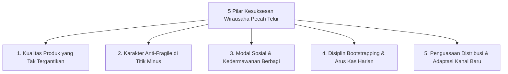

# 🧠 Anatomi Kesuksesan Wirausaha Pecah Telur
### Sintesis Data & Pola Keberhasilan dari 200 Wawancara Pelaku Usaha Indonesia

> *"Untuk maju tidak harus keturunan orang hebat, punya modal yang kuat, berpendidikan bagus, atau harus pintar sekali. Yang jelas semua punya hak yang sama untuk sukses."*  
> — **Heru Sugiarto**, Pendiri [[CV-Werisindo-PT-WarihSindo-Solusi-Teknologi-(Welsindo)-Heru-Sugiarto|CV Werisindo (Welsindo)]]

---

## 📌 Pengantar
Kanal wawancara bisnis **[Pecah Telur](https://www.youtube.com/@PecahTelur)** telah menjadi ensiklopedia hidup kewirausahaan akar rumput (*grassroots entrepreneurship*) di Indonesia. Berbeda dari buku teks bisnis formal yang kerap memuja pendanaan ventura (*venture capital*) atau jargon *startup*, kisah-kisah di Pecah Telur memperlihatkan realitas berbisnis di lapangan sesungguhnya: berhadapan dengan utang, pengkhianatan rekan kerja, kompetisi pasar lokal, keterbatasan modal, hingga dinamika keluarga.

Dokumen ini menyajikan sintesis komprehensif dari **200 studi kasus** yang telah terindeks di vault ini, membedah benang merah keberhasilan, menjawab pertanyaan krusial mengenai batas minimal modal, memetakan garis waktu menuju kestabilan bisnis, serta menghadirkan panduan tanya-jawab strategis untuk diterapkan pada usaha Anda.

---

## 🧭 BAB 1: Benang Merah Kesuksesan (The Common Thread)

Meskipun bergerak di sektor yang sangat beragam—mulai dari kuliner ceker pedas, budidaya ikan koki, pabrik shuttlecock, kontraktor industri, hingga penyedia internet korporat—para wirausahawan yang bertahan dan bertumbuh memiliki **lima pilar kesamaan fundamental**:



### 1.1 Obsesi pada Kualitas & Otentisitas Produk (*Product-Market Fit & Integrity*)
Para narasumber tidak membangun bisnis di atas tren sesaat (*hype*), melainkan berfokus menghasilkan produk yang membuat konsumen sukarela merekomendasikannya secara getok tular (*word of mouth*).
- **[[Ayam-Panggang-Bangi-Bu-Siti-Ngenaisah|Ayam Panggang Bangi (Kediri)]]**: Konsisten mempertahankan bumbu cabai murni tanpa kunyit atau pewarna selama 36 tahun, menggunakan ayam kampung asli, serta menerapkan teknik pembakaran dua tahap agar produk awet dikirim ke luar pulau tanpa pengawet kimia.
- **[[Vasco-(Shuttlecock-Vasco)-Dandhang-Siswanto|Shuttlecock Vasco (Madiun)]]**: Berawal dari mantan guru honorer yang meriset ratusan jenis bulu angsa demi menemukan kurva aerodinamika putaran dan stabilitas bobot presisi turnamen internasional.
- **[[Gudeg-Bu-Tjitro-1925-Jatmiko|Gudeg Bu Tjitro 1925 (Yogyakarta)]]**: Melakukan riset bertahun-tahun bersama LIPI untuk mengalengkan masakan tradisional agar bertahan 1 tahun tanpa merusak cita rasa gurih aslinya.

### 1.2 Karakter *Anti-Fragile* di Titik Terendah
Sebanyak **51 dari 200 narasumber (25,5%)** memulai usaha bukan dari angka nol, melainkan dari **angka MINUS** (terjerat utang ratusan juta, bangkrut, ditipu rekan bisnis, atau kehilangan pekerjaan).
- Bagi mereka, kebangkrutan bukan vonis mati, melainkan filter pembentukan karakter. Kegagalan memicu rasa tanggung jawab moral untuk mengembalikan uang orang lain dan membuktikan integritas diri.
- Contoh: **[[Shiawasenapan-Japanese-Bakehouse-Rio-Adrianto-Yudi-Satrio|Shiawasenapan Bakery]]** yang terlilit utang Rp400 juta berhasil bangkit setelah pivoting ke pasar ceruk (*niche*) roti sourdough ramah pencernaan bagi komunitas pelari kalcer di Surabaya.

### 1.3 Modal Spiritual & Kedermawanan Sosial (*Social & Spiritual Capital*)
Hampir seluruh wirausahawan yang mencapai skala puluhan miliar memiliki keyakinan kuat bahwa *rezeki bertambah dengan dialirkan, bukan ditimbun sendiri*.
- **[[R3-Jatim-Reni-Siskawati|R3 Jatim (Frozen Food Ceker)]]**: Memilih memberdayakan 170 ibu-ibu warga desa untuk mengupas ceker ayam secara manual dibandingkan membeli mesin otomatis, demi membuka lapangan nafkah bagi tetangga sekitar.
- **[[CV-Werisindo-PT-WarihSindo-Solusi-Teknologi-(Welsindo)-Heru-Sugiarto|CV Werisindo (Heru Sugiarto)]]**: Menyediakan rumah dinas, makan siang gratis, fasilitas gym/kafe, beasiswa kuliah jenjang sarjana, dan memberangkatkan umrah bagi para teknisi jaringannya.
- **Prinsip Universal**: Mereka memperlakukan karyawan bukan sebagai faktor produksi yang dieksploitasi, melainkan mitra perjuangan hidup.

### 1.4 Disiplin *Bootstrapping* & Pengendalian Arus Kas
- Menolak meminjam uang bank berbunga tinggi di awal usaha sebelum model bisnis tervalidasi.
- Menggunakan skema *cash on delivery* atau uang muka (*down payment*), memutar keuntungan harian untuk belanja bahan baku esok hari, dan memisahkan uang kas bisnis dengan dompet belanja pribadi sejak hari pertama.

### 1.5 Adaptasi Kanal Distribusi Modern
- Pelaku usaha agribisnis konvensional bertransformasi dengan memanfaatkan siaran langsung (*live streaming*) di TikTok dan marketplace (contoh: **[[Sekolah-Seller-Cap-Adit-(Aditya-S)|Sekolah Seller]]** dan **[[Jadijaya-Landscape-Tobagus-Nurbi-Alarifin|Jadijaya Landscape]]**).

---

## 💰 BAB 2: Mitos Modal Finansial: Apakah Modal Rp 0 Bisa Sukses?

Pertanyaan paling sering diajukan calon wirausahawan adalah: *“Bisakah seseorang yang tidak memiliki tabungan atau aset merintis bisnis dan mencapai omzet ratusan juta?”*

### 2.1 Fakta Empiris dari Data Vault
Analisis terhadap 200 data menunjukkan terdapat **30 usaha yang merintis dari modal tunai Rp 0 atau modal darurat di bawah Rp 500.000**.

Ketiadaan modal uang kertas disubstitusi secara cerdas dengan **Tiga Mata Uang Pengganti Uang**:

| Mata Uang Pengganti | Mekanisme Kerja | Bukti Nyata Kasus di Vault |
| :--- | :--- | :--- |
| **1. Kredibilitas & Kepercayaan (*Trust Capital*)** | Menjaga rekam jejak kejujuran sehingga supplier/vendor bersedia memberikan barang secara konsinyasi atau tempo pembayaran belakangan. | **[[CV-Werisindo-PT-WarihSindo-Solusi-Teknologi-(Welsindo)-Heru-Sugiarto|Heru Sugiarto (Welsindo)]]**: Modal Rp 0 tunai. Mendapat kepercayaan mantan pimpinan dan distributor untuk menyewa bandwidth dan perangkat pemancar nirkabel secara tempo. Kini melayani 4.000 klien korporasi. |
| **2. Keahlian & Keringat (*Sweat Equity*)** | Menjual jasa, keahlian khusus, atau waktu pengerjaan; menerima uang muka (DP) di depan sebelum melakukan belanja modal. | **[[MY-Enterprise-Michael-Yusak-Wirawan|Michael Yusak (MY Enterprise)]]**: Ditipu rekan kerja hingga tidur di jalanan, bangkit bermodalkan keahlian olah 3D sculpting digital untuk membuat prototipe figur mainan kolektor internasional. |
| **3. Sistem Konsinyasi & Pembayaran Tempo** | Mengambil komoditas dari petani/jagal, diolah menjadi produk jadi, dan uang bahan baku baru disetorkan setelah produk terjual. | **[[Akikah-Brawijaya-&-Sate-Gule-Brawijaya-Muhammad-Harddiri|Akikah Brawijaya]]**: Mengambil kambing dari jagal tanpa DP; pelunasan dilakukan setelah customer aqiqah menyelesaikan pembayaran pesta. |
| **4. Pemanfaatan Alat Pribadi yang Sudah Ada** | Menggunakan ponsel cerdas dan laptop yang sudah dimiliki untuk melayani klien digital dari kamar tidur. | **[[Creative-Leap-with-AI-Aldi|Creative Leap with AI (Aldi)]]**: Menghasilkan puluhan juta rupiah dari kamar kos dengan memanfaatkan keahlian prompt engineering dan generative design untuk klien luar negeri. |

> **Prinsip Utama Modal**:  
> Modal uang hanyalah **pengungkit kecepatan (*speed multiplier*)**, bukan fondasi utama. Jika uang belum ada, pengungkit yang wajib dipakai adalah **integritas janji, keahlian spesifik, dan jam terbang kerja keras**.

---

## ⏳ BAB 3: Garis Waktu Kesuksesan (Fastest vs Sweet Spot vs Longest)

Berapa lama waktu yang sebenarnya dibutuhkan untuk keluar dari masa kritis dan mencapai kebebasan finansial? Dari 200 catatan wawancara, garis waktu terbagi ke dalam tiga kelompok:

```
┌─────────────────────────┬──────────────────────┬──────────────────────────────────────────────┐
│ Klaster Garis Waktu     │ Rentang Durasi       │ Sektor & Karakteristik Model Usaha           │
├─────────────────────────┼──────────────────────┼──────────────────────────────────────────────┤
│ ⚡ Klaster Cepat        │ 3 – 6 Bulan          │ Produk Digital, Agribisnis Sayur Cepat,      │
│                         │                      │ Jasa Desain AI, Live Commerce Affiliate      │
├─────────────────────────┼──────────────────────┼──────────────────────────────────────────────┤
│ 🎯 Klaster Rata-rata    │ 3 – 5 Tahun          │ Usaha Kuliner Mandiri, Peternakan, Konveksi, │
│    (The Sweet Spot)     │                      │ Jasa Laundry Multi-Cabang, Kontraktor B2B    │
├─────────────────────────┼──────────────────────┼──────────────────────────────────────────────┤
│ 🏛️ Klaster Generasional │ 20 – 40+ Tahun       │ Merek Ikonik Oleh-Oleh, Manufaktur Berat,    │
│    (The Long-Haul)      │                      │ Pabrik Tekstil, Holding Bisnis Keluarga      │
└─────────────────────────┴──────────────────────┴──────────────────────────────────────────────┘
```

### 3.1 Klaster Cepat (3–6 Bulan)
Terjadi pada model bisnis yang memiliki **siklus perputaran panen pendek** atau **skalabilitas digital tanpa inventori fisik**:
- **[[Kebun-Pakcoy-Mbak-Putri-(Open-Farm-Pakcoy-Kepatihan)-Putri|Kebun Pakcoy Mbak Putri]]**: Waktu tanam sayuran hidroponik/organik hanya 30–40 hari per siklus. Dalam waktu 3–4 bulan sudah balik modal (BEP) dan mencetak laba bersih Rp17 juta/bulan.
- **[[Melon-Ponik-Ahmad-Lavina-Romadi-(Lavilian)|Melon-Ponik]]**: Pertanian melon modern dalam greenhouse menghasilkan panen 5–7 kali setahun; panen ke-3 sudah menutup seluruh biaya instalasi awal.
- **[[Creative-Leap-with-AI-Aldi|Creative Leap with AI]]**: Tidak membutuhkan rantai pasok fisik; begitu portofolio digital diunggah ke platform global, pesanan langsung masuk dalam hitungan minggu.

### 3.2 Klaster *Sweet Spot* (3–5 Tahun)
Merupakan jalan normal yang ditempuh oleh **70% pelaku usaha Pecah Telur**:
- **Tahun 1**: Fase kelam (*Valley of Death*), uji coba resep, sering sepi pembeli, pendapatan pribadi pas-pasan atau bahkan nombok.
- **Tahun 2**: Menemukan *Product-Market Fit*, pelanggan tetap mulai terbentuk, operasional mulai tertata.
- **Tahun 3–5**: Skala produksi berlipat, utang rintisan lunas, mulai membuka cabang atau memperluas kandang/gudang, dan sistem operasional dapat didelegasikan ke karyawan.

### 3.3 Klaster Generasional (20–40+ Tahun)
Dibutuhkan untuk membangun **reputasi budaya dan institusi regional**:
- **[[Bakpia-Pathok-25-Perintis-Bakpia-Pathok-25-(Generasi-Pembuat-Bakpia-No.-25)|Bakpia Pathok 25]]** & **[[Gudeg-Bu-Tjitro-1925-Jatmiko|Gudeg Bu Tjitro 1925]]**: Mengalami pasang surut puluhan tahun, pergantian generasi, hingga menjadi identitas kuliner resmi kota Yogyakarta.
- **[[Ayam-Panggang-Bangi-Bu-Siti-Ngenaisah|Ayam Panggang Bangi]]**: 36 tahun mematangkan resep warisan ibu mertua hingga kini mampu memanggang 500 ekor ayam per hari pada momen Idulfitri.

---

## ❓ BAB 4: Tanya-Jawab Strategis (Strategic Q&A Playbook)

Berikut elaborasi atas pertanyaan-pertanyaan krusial seputar dunia wirausaha yang diekstraksi dari pengalaman nyata para narasumber:

### Q1: Bagaimana cara mereka melunasi utang ratusan juta tanpa terjerumus pinjaman baru?
**Pola Tindakan**:
1. **Tidak Menghilang dari Kreditur**: Narasumber mendatangi pemilik piutang secara langsung, mengakui kondisi keuangan dengan jujur, dan meminta penjadwalan ulang pembayaran pokok tanpa bunga tambahan.
2. **Memangkas Pengeluaran Pribadi ke Tingkat Ekstrem**: Gaya hidup diturunkan total; tidak membeli aset baru sebelum utang teratasi.
3. **Mengalokasikan Laba Harian secara Parsial**: Membagi hasil harian: 30% untuk modal kerja esok hari, 50% untuk angsuran utang pokok, dan 20% untuk nafkah pokok keluarga.
4. **Pivoting ke Produk dengan Margin Bersih Tinggi**: Contohnya pada kisah **[[Shiawasenapan-Japanese-Bakehouse-Rio-Adrianto-Yudi-Satrio|Shiawasenapan Bakery]]** yang beralih ke roti sourdough premium dengan margin per bungkus yang mampu mempercepat pelunasan utang Rp400 juta.

---

### Q2: Mengapa banyak kuliner Pecah Telur yang sangat viral menolak sistem waralaba (*Franchise*) atau buka cabang banyak?
**Pola Tindakan**:
1. **Integritas Kontrol Rasa (*Quality Control*)**: Bumbu tradisional, teknik memanggang arang, dan kelembutan adonan sangat rentan berubah rasa bila ditangani oleh pihak ketiga yang mengejar efisiensi biaya.
2. **Fokus pada Volume Satu Pintu (*Single-Store High Density*)**: Menjual 500 ekor ayam di satu gerai utama ([Ayam Panggang Bangi](file:///root/.gemini/antigravity-cli/scratch/ringkasan-pecah-telur-channel/Kisah-Sukses/Ayam-Panggang-Bangi-Bu-Siti-Ngenaisah.md)) jauh lebih menguntungkan dan minim stres pengawasan dibandingkan mengelola 10 gerai cabang kecil yang masing-masing hanya menjual 50 ekor namun dibebani biaya sewa ruko dan gaji manajer.
3. **Menciptakan Destinasi Wisata Kuliner**: Orang rela datang dari luar kota atau luar pulau khusus untuk mengunjungi lokasi aslinya.

---

### Q3: Bagaimana cara mereka mencegah pencurian resep atau pembajakan oleh karyawan kunci?
**Pola Tindakan**:
1. **SOP Formulasi Tersekat (*Compartmentalization*)**: Resep bumbu inti atau biang pakan diproduksi secara tertutup oleh pemilik/keluarga inti di ruang terpisah. Karyawan dapur hanya bertugas mencampur bumbu jadi sesuai takaran timbangan.
2. **Ikatan Kesejahteraan & Kemanusiaan**: Mengubah relasi kerja dari sekadar "buruh-majikan" menjadi "keluarga besar". Karyawan diberi insentif bonus bagi hasil, tempat tinggal, dan bantuan finansial saat keluarga sakit, sehingga rasa memiliki (*sense of belonging*) tinggi dan enggan berkhianat.

---

### Q4: Bagaimana cara narasumber menemukan peluang pasar *Blue Ocean* di pedesaan?
**Pola Tindakan**:
Mereka tidak mencari produk yang canggih, melainkan mengamati **masalah lokal yang belum terselesaikan atau limbah yang terbuang sia-sia**:
- **Limbah Daging Jadi Cuan**: Ceker ayam yang semula murah dan dianggap limbah dipisahkan tulangnya secara higienis, dibekukan, dan menjadi pasokan reguler resto pedas ([R3 Jatim](file:///root/.gemini/antigravity-cli/scratch/ringkasan-pecah-telur-channel/Kisah-Sukses/R3-Jatim-Reni-Siskawati.md)).
- **Limbah Kelapa Zero Waste**: Sabut kelapa diolah jadi cocopeat media tanam ekspor, tempurung jadi arang briket hookah, dan airnya jadi nata de coco ([Usaha Pengolahan Kelapa Zero Waste](file:///root/.gemini/antigravity-cli/scratch/ringkasan-pecah-telur-channel/Kisah-Sukses/Usaha-Pengolahan-Kelapa-&-Turunannya-(Zero-Waste)-Hilmi-Mubarok.md)).
- **Rumput Hias di Lahan Sawah**: Mengubah sawah tadah hujan menjadi hamparan budidaya rumput gajah mini dan paku-pakuan lanskap perumahan ([Jadijaya Landscape](file:///root/.gemini/antigravity-cli/scratch/ringkasan-pecah-telur-channel/Kisah-Sukses/Jadijaya-Landscape-Tobagus-Nurbi-Alarifin.md)).

---

### Q5: Kapan momen yang tepat bagi seorang karyawan untuk mengundurkan diri (*resign*) dan fokus berbisnis?
**Pola Tindakan**:
Narasumber yang berlatar belakang pekerja kantoran atau guru (seperti pada kisah **[[Vasco-(Shuttlecock-Vasco)-Dandhang-Siswanto|Dandhang Siswanto]]** atau **[[Kebun-Pakcoy-Mbak-Putri-(Open-Farm-Pakcoy-Kepatihan)-Putri|Putri Kebun Pakcoy]]**) merekomendasikan:
1. **Validasi Sampingan (*Moonlighting Validation*)**: Rintis bisnis di luar jam kerja (malam hari atau akhir pekan) hingga produk terbukti dibeli oleh orang asing (bukan sekadar teman/keluarga).
2. **Kriteria Finansial**: Laba bersih usaha sampingan mampu menutup minimal **1,5x sampai 2x biaya kebutuhan hidup bulanan** selama 6 bulan berturut-turut.
3. **Kapasitas Fisik**: Saat pesanan yang masuk sudah tidak lagi mampu dipenuhi tanpa kehadiran penuh diri Anda.

---

### Q6: Bagaimana tata kelola bisnis keluarga (*Family Business*) agar tidak pecah kongsi di generasi kedua?
**Pola Tindakan**:
1. **Pemisahan Peran yang Jelas**: Tidak boleh ada otoritas ganda. Ditentukan secara tegas siapa penanggung jawab rasa/dapur, siapa penanggung jawab logistik, dan siapa penanggung jawab keuangan.
2. **Pemisahan Kas Mutlak**: Uang hasil penjualan di kasir diharamkan dipakai langsung untuk membeli beras rumah tangga atau kebutuhan pribadi tanpa melalui sistem gaji/jatah deviden berkala.
3. **Aturan Bagi Hasil Tertulis**: Keuntungan dibagi secara proporsional sesuai kontribusi kerja harian dan persentase kepemilikan modal awal.

---

## 📋 BAB 5: Rangkuman Checklist bagi Calon Pengusaha

Bila Anda berniat memulai atau merestrukturisasi usaha Anda hari ini, gunakan checklist 7 langkah yang terbukti dari 200 kisah Pecah Telur:

- [ ] **Langkah 1**: Mulai dari masalah atau komoditas terdekat yang ada di sekitar Anda, bukan produk fiktif yang Anda sendiri tidak paham.
- [ ] **Langkah 2**: Manfaatkan apa yang ada di tangan (keterampilan, ponsel, relasi kejujuran) tanpa menunggu pinjaman bank cair.
- [ ] **Langkah 3**: Buat produk yang kualitasnya membuat Anda sendiri bangga mengonsumsinya setiap hari.
- [ ] **Langkah 4**: Jual ke 10 pelanggan pertama, dengarkan kritik pedas mereka, dan perbaiki formula hingga terjadi pembelian ulang (*repeat order*).
- [ ] **Langkah 5**: Pisahkan rekening pribadi dengan kas usaha sejak transaksi Rp 10.000 pertama.
- [ ] **Langkah 6**: Gunakan media sosial (video proses pembuatan, transparansi operasional) untuk membangun kedekatan emosional dengan audiens.
- [ ] **Langkah 7**: Alokasikan sebagian rezeki untuk membantu orang di sekitar Anda sejak bisnis masih berskala kecil.

---

## 🔗 Tautan Dokumen Terkait
- **Beranda Master Indeks**: [[00 - Index Pecah Telur]]
- **Direktori Kisah Sukses**: Folder [[Kisah-Sukses/]]
- **Daftar Kategori Industri**: Folder [[Kategori/]]
- **Repositori Daring**: [GitHub arifrhm/ringkasan-pecah-telur-channel](https://github.com/arifrhm/ringkasan-pecah-telur-channel)
